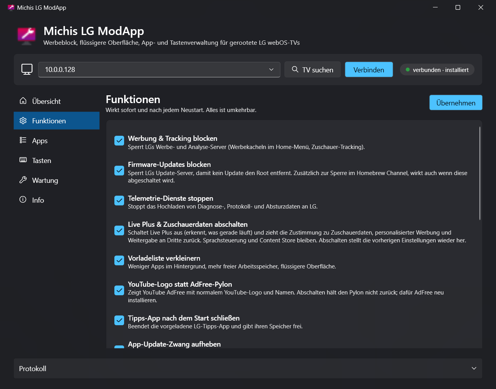
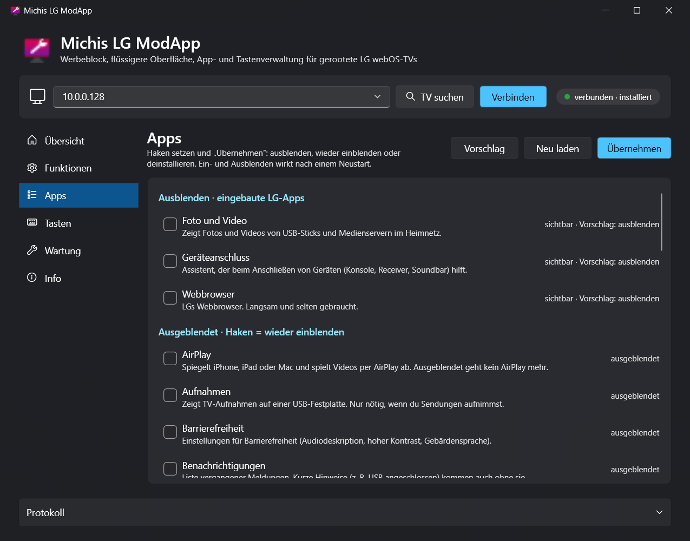
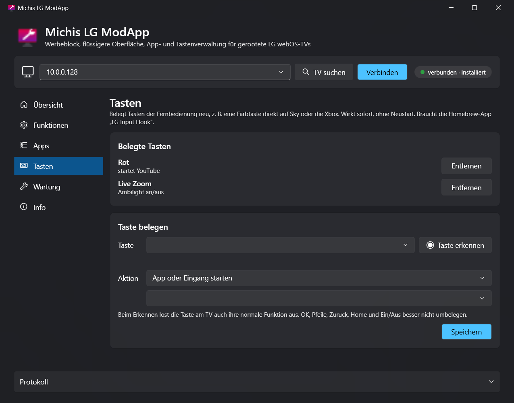
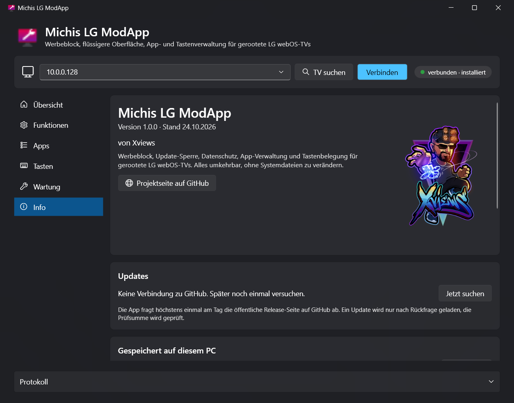

  

<h1 align="center">Michis LG ModApp</h1>

  <b>Mehr aus deinem gerooteten LG-TV holen, mit einem Klick.</b> 
  Werbung weg, Root geschützt, Apps aufgeräumt, Tasten frei belegt. Alles umkehrbar.

  

  <a href="#so-gehts">So geht's</a> ·
  <a href="#funktionen">Funktionen</a> ·
  <a href="#download">Download</a> ·
  <a href="#wichtig">Wichtig</a>

Privates Projekt ohne Verbindung zu LG Electronics. „LG“ und „webOS“ sind Marken von LG Electronics.

---

Werbekacheln im Home-Menü, Firmware-Updates, die den Root wieder entfernen, ein Dutzend LG-Apps, die niemand braucht, und Live Plus, das mitschaut, was gerade läuft. **Die ModApp räumt das auf:** Das kostenlose Windows-Tool findet deinen TV im Netzwerk und stellt alles mit ein paar Haken ein. Es verändert keine Systemdateien, und alles lässt sich mit einem Klick wieder entfernen.

  

## So geht's

| 1️⃣ Verbinden | 2️⃣ Installieren | 3️⃣ Einstellen |
|---|---|---|
| App starten. Sie sucht den TV im Netzwerk und verbindet sich. Beim ersten Mal einmal das root-Passwort eingeben (Homebrew-Standard: `alpine`). | In der Übersicht auf **Installieren** klicken. Ab jetzt wirkt alles sofort und nach jedem Neustart. | Funktionen an- und abschalten, Apps ausblenden, Tasten belegen. Fertig. |

**Voraussetzung:** ein gerooteter LG-TV mit [Homebrew Channel](https://github.com/webosbrew/webos-homebrew-channel), dort **SSH** eingeschaltet. Rooten geht z. B. mit [RootMyTV](https://rootmy.tv/) oder [faultmanager-autoroot](https://github.com/throwaway96/faultmanager-autoroot), je nach Firmware.

## Funktionen

**Schutz & Datenschutz**
- 🚫 **Werbung & Tracking blocken:** sperrt LGs Werbe- und Analyse-Server, eigene Domains lassen sich ergänzen. Content Store und Apps funktionieren weiter.
- 🛡️ **Firmware-Updates blocken:** Ein Update entfernt den Root. Die Sperre greift zusätzlich zu der im Homebrew Channel, auch wenn diese mal aus ist.
- 🕵️ **Live Plus & Zuschauerdaten abschalten:** Live Plus erkennt per Bildabgleich, was läuft. Die App schaltet es aus und zieht die Zustimmung zu Zuschauerdaten, personalisierter Werbung und Weitergabe an Dritte zurück. Sprachsteuerung und Content Store bleiben.
- 📡 **Telemetrie stoppen:** keine Diagnose-, Protokoll- und Absturzdaten mehr an LG.
- 🔓 **App-Update-Zwang aufheben:** Verlangt LG ein Update, bevor eine App startet, leert die App diese Liste. Wichtig für YouTube AdFree. Der Content Store bleibt voll nutzbar.

**Tempo**
- ⚡ **Vorladeliste verkleinern:** LG hält bis zu vier Apps im Hintergrund bereit. Weniger davon heißt mehr freier Arbeitsspeicher und eine flüssigere Oberfläche. Welche Apps vorladen dürfen, stellst du selbst ein.
- 🧹 **Tipps-App nach dem Start schließen** und ihren Speicher freigeben.

**Apps**
- 🗂️ **LG-Apps ausblenden,** die sich sonst nicht entfernen lassen (Musik, Browser, Galerie, Anleitung …). Mit Erklärung zu jeder App und einem Vorschlag, was weg kann. Auch Live TV, Programmführer, Screen Share und AirPlay, wer nur über HDMI schaut.
- 🗑️ **Installierte Apps deinstallieren** und ausgeblendete Apps wieder einblenden.
- ▶️ **YouTube-Logo statt AdFree-Pylon:** YouTube AdFree sieht im Menü wieder aus wie YouTube.

**Tasten**
- 🎮 **Fernbedienung neu belegen** (über [LG Input Hook](https://github.com/Simon34545/lginputhook), die App installiert ihn auf Wunsch): Taste drücken, die App erkennt sie. Dann z. B. direkt auf Sky, Xbox oder YouTube schalten, Bildschirm aus mit Ton weiter, Ambilight an/aus, Taste abschalten. Wirkt sofort, ohne Neustart.

**Außerdem**
- 🔄 **Startet der TV über die App neu, verbindet sie sich danach von selbst.**
- ⬆️ **Updates mit einem Klick:** Die App meldet neue Versionen, lädt sie nach Rückfrage, prüft die Prüfsumme und startet neu.

<table>
  <tr>
    <td width="50%"></td>
    <td width="50%"></td>
  </tr>
  <tr>
    <td align="center">Funktionen</td>
    <td align="center">Apps ausblenden</td>
  </tr>
  <tr>
    <td width="50%"></td>
    <td width="50%"></td>
  </tr>
  <tr>
    <td align="center">Tasten belegen</td>
    <td align="center">Info &amp; Updates</td>
  </tr>
</table>

## Download

| Datei | Größe | Hinweis |
|---|---|---|
| [`MichisLgModApp.exe`](https://github.com/xviews/xviews-lg-modapp/releases/latest/download/MichisLgModApp.exe) | ca. 60 MB | läuft sofort, keine Installation |

**Voraussetzungen:** Windows 10 oder 11 (64 Bit), TV im selben Netzwerk. ➡️ Alle Versionen und Prüfsummen unter **[Releases](../../releases)**.

**Getestet mit:** LG 65SK8500LLA, webOS 4.4.2, Firmware 05.50.15. Andere webOS-4-Modelle sollten genauso laufen. Bei neueren webOS-Versionen bitte Rückmeldung geben.

**Sicherheit:** Die Prüfsumme (SHA-256) jeder Version steht im Release-Text. Mit `Get-FileHash .\MichisLgModApp.exe` in PowerShell kannst du sie selbst prüfen. Der Release-Text verlinkt außerdem das VirusTotal-Ergebnis.

<b>Beim ersten Start</b>

- Meldet SmartScreen „Der Computer wurde durch Windows geschützt“, auf **„Weitere Informationen“** und dann auf **„Trotzdem ausführen“** klicken. Die EXE ist nicht signiert, weil ein Zertifikat Geld kostet.
- Beim ersten Verbinden öffnet sich ein schwarzes Fenster: dort einmal das root-Passwort des TVs eingeben (Homebrew-Channel-Standard: `alpine`). Danach meldet sich die App mit einem SSH-Schlüssel an (`%USERPROFILE%\.ssh\lgtv_ed25519`).
- Findet die App den TV nicht, die IP eintragen. Sie steht am TV unter *Einstellungen → Netzwerk → Verbindung → Erweiterte Einstellungen*.

## Wichtig

- ⚠️ Setzt einen **gerooteten** TV voraus. Rooten kann die Garantie berühren. Nutzung auf eigene Verantwortung.
- ↩️ Alles ist umkehrbar: **Wartung → Deinstallieren** setzt den TV in den Originalzustand zurück. Es werden keine Systemdateien verändert; `/etc/hosts` wird nur als Kopie im Arbeitsspeicher bearbeitet.
- 📺 **YouTube AdFree** zeigt im Content Store „Es wird auf eine Aktualisierung gewartet“. Nicht aktualisieren, sonst kommt die Version mit Werbung zurück.
- 🚫 Das Tool sammelt keine Daten und schickt nichts an mich.

<b>Was die App auf dem TV macht</b>

- Alle Dateien liegen in `/media/developer/debloat`, gestartet wird beim Hochfahren über `/var/lib/webosbrew/init.d/60-debloat` des Homebrew Channels.
- **Werbeblock und Update-Sperre:** Einträge in einer Arbeitsspeicher-Kopie von `/etc/hosts`. Bewusst nicht geblockt: `ngfts.lge.com` (Bilder im Content Store) und die `*.lgtvsdp.com`-Server (App-Store, App-Start).
- **Telemetrie:** Die Dienste `remotelogger`, `uploadd` und `crashreportd` werden angehalten.
- **Live Plus & Zuschauerdaten:** Einstellungen über LGs eigenen Einstellungsdienst. Die vorherigen Werte werden gesichert und beim Abschalten wiederhergestellt.
- **Apps ausblenden:** Einträge in LGs Liste gelöschter Systemapps. Die App merkt sich, was sie selbst eingetragen hat, und nimmt beim Deinstallieren nur diese Einträge wieder heraus.
- **Tasten:** `/home/root/.config/lginputhook/keybinds.json` von LG Input Hook, vorhandene Belegungen bleiben erhalten.

<b>Wann die App ins Internet geht</b>

- **Update-Suche:** Die öffentliche Release-Seite auf GitHub wird höchstens einmal am Tag abgefragt.
- **LG Input Hook installieren:** Nur wenn du auf „Installieren“ klickst. Dann liest die App den offiziellen Homebrew-Katalog (repo.webosbrew.org), und der Homebrew Channel lädt die App auf dem TV und prüft ihre Prüfsumme.
- Sonst spricht die App nur mit deinem TV im Heimnetz.

<b>Notfall: die App geht nicht mehr</b>

Per SSH oder Telnet die Datei `/var/lib/webosbrew/init.d/60-debloat` löschen und den TV neu starten. Alternativ im Homebrew Channel die Startskripte abschalten. Ausgeblendete Apps stehen in `/var/preferences/com.webos.applicationManager/deletedSystemAppList.json`, die Vorladeliste setzt `luna-send -n 1 luna://com.webos.service.config/reconfigure '{}'` zurück.

## Danke

Ohne die webOS-Homebrew-Community ginge das alles nicht: [webosbrew](https://github.com/webosbrew) mit dem Homebrew Channel, [openlgtv](https://openlgtv.github.io/) und RootMyTV, [LG Input Hook](https://github.com/Simon34545/lginputhook) von Simon34545 und der [LG App Update Blocker](https://github.com/dr0dr1dr2dr3/lgappupdateblocker) als Vorbild für den aufgehobenen Update-Zwang.

## Über den Namen

Eigentlich sollte es nur ein Skript für meinen eigenen Fernseher werden: Werbung weg, Updates aus. Dann hatte ein Kumpel denselben TV, und aus dem Skript wurde eine App, die man einfach weitergeben kann. Deshalb heißt sie, wie sie heißt: **Michis LG ModApp**, von Michi (Xviews), für jeden mit einem gerooteten LG.
