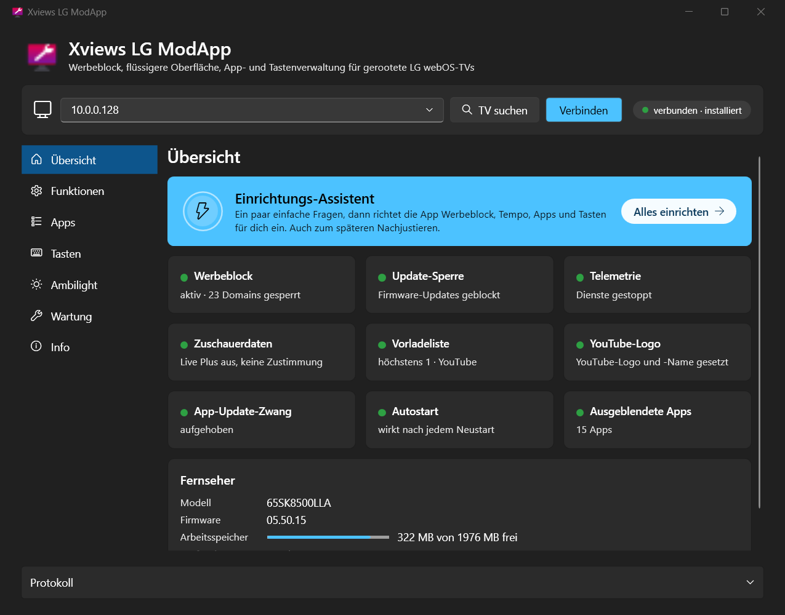
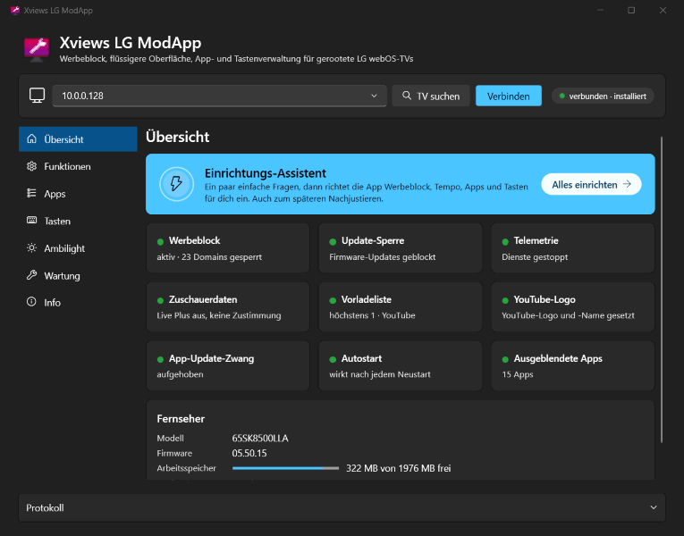
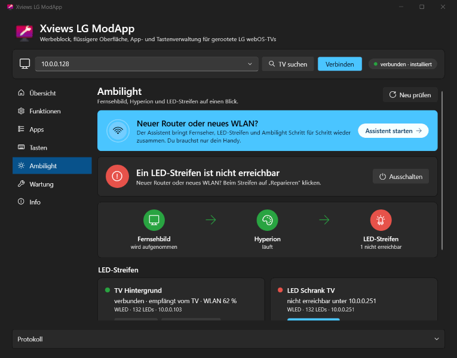
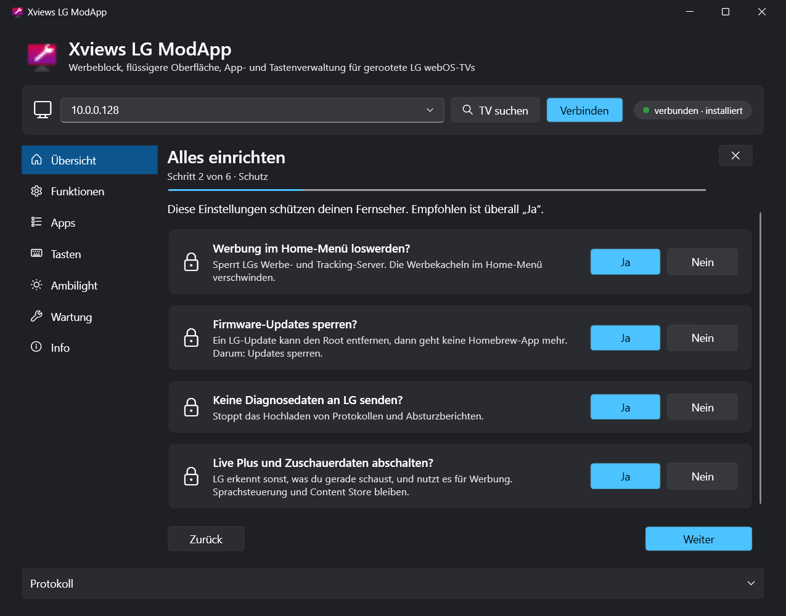
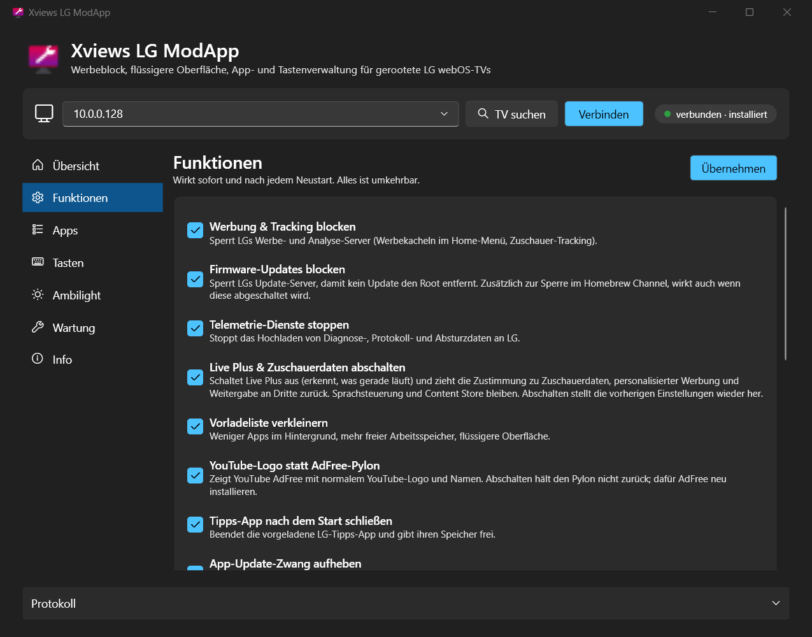
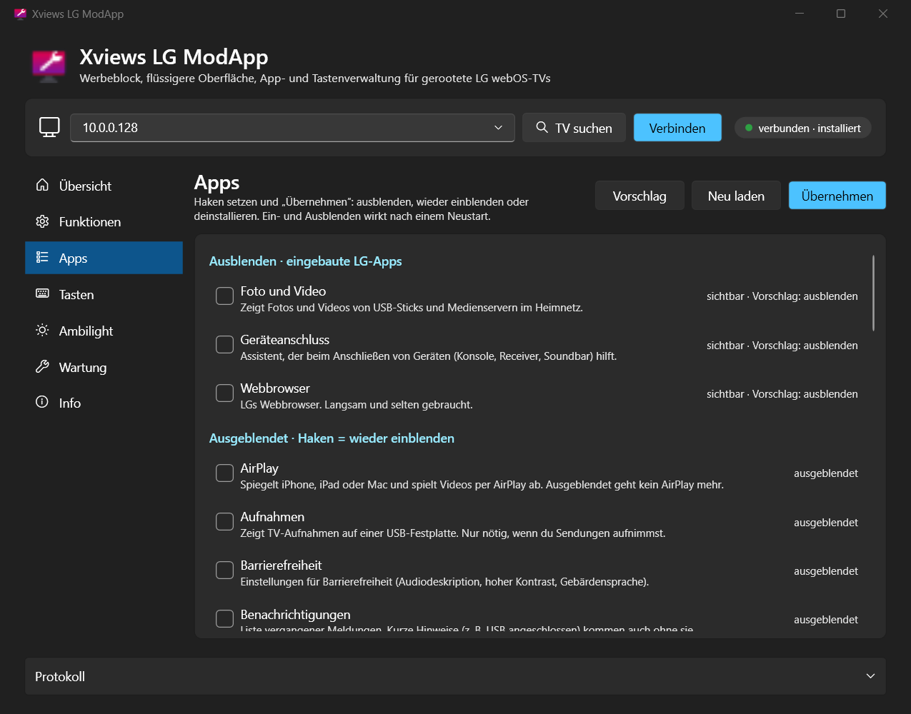
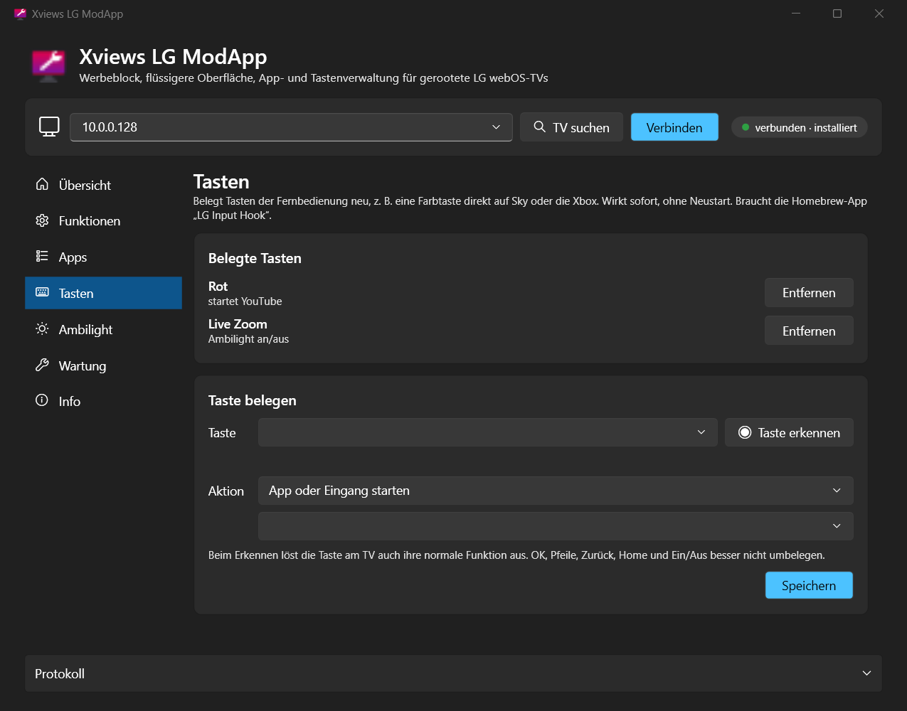
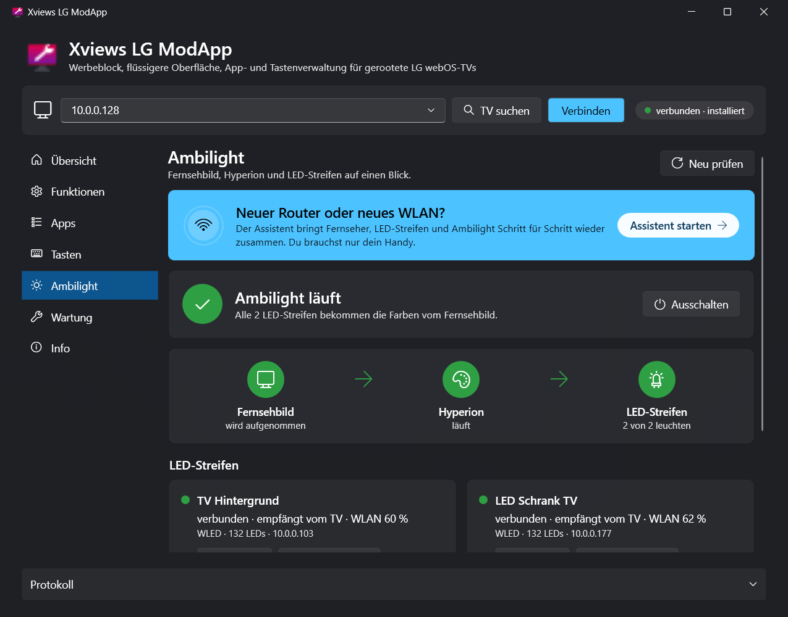
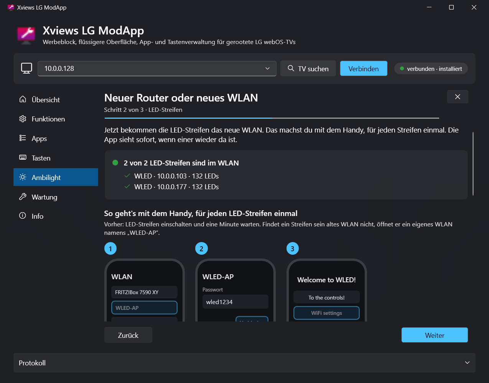
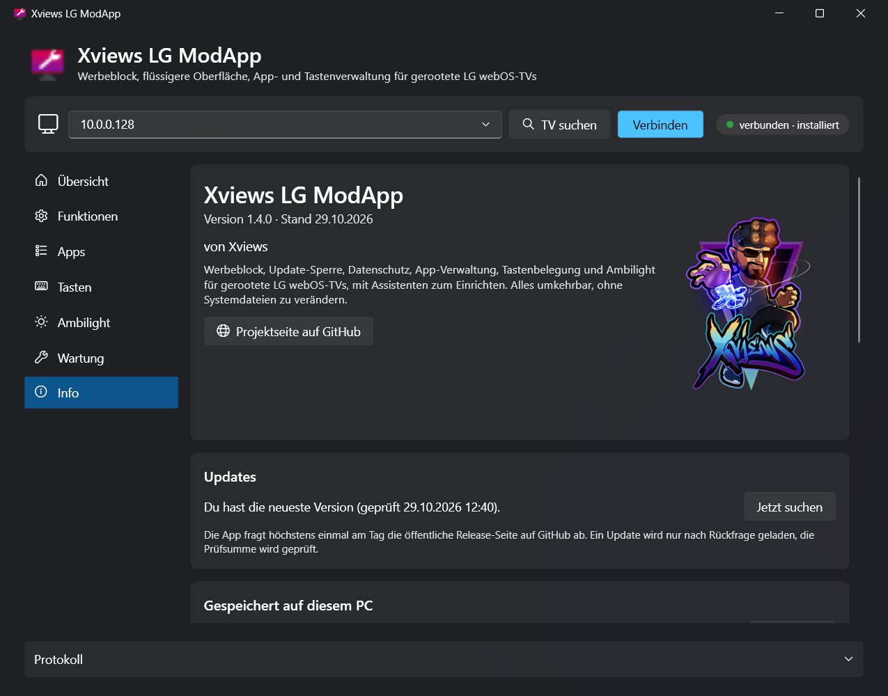

  

<h1 align="center">Xviews LG ModApp</h1>

  <b>Mehr aus deinem gerooteten LG-TV holen, mit einem Klick.</b> 
  Werbung weg, Root geschützt, Apps aufgeräumt, Tasten frei belegt, Ambilight im Griff. Alles umkehrbar.

  

  <a href="#so-gehts">So geht's</a> ·
  <a href="#funktionen">Funktionen</a> ·
  <a href="#download">Download</a> ·
  <a href="#wichtig">Wichtig</a>

Privates Projekt ohne Verbindung zu LG Electronics. „LG“ und „webOS“ sind Marken von LG Electronics.

---

Werbekacheln im Home-Menü, Firmware-Updates, die den Root wieder entfernen, ein Dutzend LG-Apps, die niemand braucht, und Live Plus, das mitschaut, was gerade läuft. **Die ModApp räumt das auf:** Das kostenlose Windows-Tool findet deinen TV im Netzwerk, und ein Assistent stellt mit ein paar Ja/Nein-Fragen alles ein. Es verändert keine Systemdateien, und alles lässt sich mit einem Klick wieder entfernen.

  

## So geht's

| 1️⃣ Starten | 2️⃣ Fragen beantworten | 3️⃣ Übernehmen |
|---|---|---|
| App starten. Der Einrichtungs-Assistent öffnet sich, sucht den TV und verbindet sich. Beim ersten Mal einmal das root-Passwort eingeben (Homebrew-Standard: `alpine`). | Werbung weg? Flüssiger? Welche Apps nutzt du nie? Welche Farbtaste soll was öffnen? Die Empfehlung ist schon gewählt. | **Alles übernehmen** klicken. Ab jetzt wirkt alles sofort und nach jedem Neustart. Später lässt sich alles einzeln nachjustieren. |

**Voraussetzung:** ein gerooteter LG-TV mit [Homebrew Channel](https://github.com/webosbrew/webos-homebrew-channel), dort **SSH** eingeschaltet. Rooten geht z. B. mit [RootMyTV](https://rootmy.tv/) oder [faultmanager-autoroot](https://github.com/throwaway96/faultmanager-autoroot), je nach Firmware.

## Funktionen

**Einrichtungs-Assistent**
- 🪄 **Alles in ein paar Minuten:** einfache Ja/Nein-Fragen zu Schutz, Tempo, Apps und Farbtasten, die Empfehlung ist schon gewählt. Erst ganz am Ende wird alles auf einmal übernommen, wer vorher abbricht, hat nichts verändert. Öffnet sich beim ersten Start von selbst und eignet sich auch zum späteren Nachjustieren.

  

**Schutz & Datenschutz**
- 🚫 **Werbung & Tracking blocken:** sperrt LGs Werbe- und Analyse-Server, eigene Domains lassen sich ergänzen. Content Store und Apps funktionieren weiter.
- 🛡️ **Firmware-Updates blocken:** Ein Update entfernt den Root. Die Sperre greift zusätzlich zu der im Homebrew Channel, auch wenn diese mal aus ist.
- 🕵️ **Live Plus & Zuschauerdaten abschalten:** Live Plus erkennt per Bildabgleich, was läuft. Die App schaltet es aus und zieht die Zustimmung zu Zuschauerdaten, personalisierter Werbung und Weitergabe an Dritte zurück. Sprachsteuerung und Content Store bleiben.
- 📡 **Telemetrie stoppen:** keine Diagnose-, Protokoll- und Absturzdaten mehr an LG.
- 🔓 **App-Update-Zwang aufheben:** Verlangt LG ein Update, bevor eine App startet, leert die App diese Liste. Wichtig für YouTube AdFree. Der Content Store bleibt voll nutzbar.

**Tempo**
- ⚡ **Vorladeliste verkleinern:** LG hält bis zu vier Apps im Hintergrund bereit. Weniger davon heißt mehr freier Arbeitsspeicher und eine flüssigere Oberfläche. Welche Apps vorladen dürfen, stellst du selbst ein.
- 🧹 **Tipps-App nach dem Start schließen** und ihren Speicher freigeben.

**Apps**
- 🗂️ **LG-Apps ausblenden,** die sich sonst nicht entfernen lassen (Musik, Browser, Galerie, Anleitung …). Mit Erklärung zu jeder App und einem Vorschlag, was weg kann. Auch Live TV, Programmführer, Screen Share und AirPlay, wer nur über HDMI schaut.
- 🗑️ **Installierte Apps deinstallieren** und ausgeblendete Apps wieder einblenden.
- ▶️ **YouTube-Logo statt AdFree-Pylon:** YouTube AdFree sieht im Menü wieder aus wie YouTube.

**Tasten**
- 🎮 **Fernbedienung neu belegen** (über [LG Input Hook](https://github.com/Simon34545/lginputhook), die App installiert ihn auf Wunsch): Taste drücken, die App erkennt sie. Dann z. B. direkt auf Sky, Xbox oder YouTube schalten, Bildschirm aus mit Ton weiter, Ambilight an/aus, Taste abschalten. Wirkt sofort, ohne Neustart.

**Ambilight** (für [Hyperion.NG](https://github.com/webosbrew/hyperion.ng-webos-loader) mit [PicCap](https://github.com/TBSniller/piccap) und [WLED](https://kno.wled.ge/)-Streifen)
- 💡 **Alles auf einen Blick:** Läuft die Bildaufnahme, läuft Hyperion, leuchten die LED-Streifen? Ambilight mit einem Klick an und aus, Hyperion- und WLED-Einstellungen direkt öffnen, jeden Streifen kurz rot blinken lassen.
- 📶 **Assistent für neuen Router oder neues WLAN:** Führt Schritt für Schritt mit Bildern durch, wie Fernseher und LED-Streifen ins neue WLAN kommen. Hat der PC WLAN, erledigt er das für die Streifen selbst: kurz mit „WLED-AP“ verbinden, dein WLAN eintragen, zurück ins eigene Netz. Sonst geht es mit dem Handy. Die App sieht live, wenn alles wieder da ist, lässt bei Bedarf jeden Streifen blinken und fragt, welcher es ist, und trägt die neuen Adressen in Hyperion ein. Vorher wird eine Sicherung angelegt.

  

**Außerdem**
- 🔄 **Startet der TV über die App neu, verbindet sie sich danach von selbst.**
- 🖥️ **Scharf auf jedem Bildschirm:** passt sich der Windows-Skalierung pro Monitor an und passt auch auf kleine Laptop-Bildschirme.
- ⬆️ **Updates mit einem Klick:** Gibt es eine neue Version, zeigt die App einmal kurz, was neu ist. Ein Klick lädt sie, prüft die Prüfsumme und startet neu.

<table>
  <tr>
    <td width="50%"></td>
    <td width="50%"></td>
  </tr>
  <tr>
    <td align="center">Einrichtungs-Assistent</td>
    <td align="center">Funktionen</td>
  </tr>
  <tr>
    <td width="50%"></td>
    <td width="50%"></td>
  </tr>
  <tr>
    <td align="center">Apps ausblenden</td>
    <td align="center">Tasten belegen</td>
  </tr>
  <tr>
    <td width="50%"></td>
    <td width="50%"></td>
  </tr>
  <tr>
    <td align="center">Ambilight</td>
    <td align="center">Neuer Router oder neues WLAN</td>
  </tr>
  <tr>
    <td width="50%"></td>
    <td width="50%"></td>
  </tr>
  <tr>
    <td align="center">Info &amp; Updates</td>
    <td></td>
  </tr>
</table>

## Download

| Datei | Größe | Hinweis |
|---|---|---|
| [`XviewsLgModApp.exe`](https://github.com/xviews/xviews-lg-modapp/releases/latest/download/XviewsLgModApp.exe) | ca. 60 MB | läuft sofort, keine Installation |

**Voraussetzungen:** Windows 10 oder 11 (64 Bit), TV im selben Netzwerk. ➡️ Alle Versionen und Prüfsummen unter **[Releases](../../releases)**.

**Getestet mit:** LG 65SK8500LLA, webOS 4.4.2, Firmware 05.50.15. Andere webOS-4-Modelle sollten genauso laufen. Bei neueren webOS-Versionen bitte Rückmeldung geben.

**Sicherheit:** Die Prüfsumme (SHA-256) jeder Version steht im Release-Text. Mit `Get-FileHash .\XviewsLgModApp.exe` in PowerShell kannst du sie selbst prüfen. Der Release-Text verlinkt außerdem das VirusTotal-Ergebnis.

<b>Beim ersten Start</b>

- Meldet SmartScreen „Der Computer wurde durch Windows geschützt“, auf **„Weitere Informationen“** und dann auf **„Trotzdem ausführen“** klicken. Die EXE ist nicht signiert, weil ein Zertifikat Geld kostet.
- Beim ersten Verbinden öffnet sich ein schwarzes Fenster: dort einmal das root-Passwort des TVs eingeben (Homebrew-Channel-Standard: `alpine`). Danach meldet sich die App mit einem SSH-Schlüssel an (`%USERPROFILE%\.ssh\lgtv_ed25519`).
- Findet die App den TV nicht, die IP eintragen. Sie steht am TV unter *Einstellungen → Netzwerk → Verbindung → Erweiterte Einstellungen*.

## Wichtig

- ⚠️ Setzt einen **gerooteten** TV voraus. Rooten kann die Garantie berühren. Nutzung auf eigene Verantwortung.
- ↩️ Alles ist umkehrbar: **Wartung → Deinstallieren** setzt den TV in den Originalzustand zurück. Es werden keine Systemdateien verändert; `/etc/hosts` wird nur als Kopie im Arbeitsspeicher bearbeitet.
- 📺 **YouTube AdFree** zeigt im Content Store „Es wird auf eine Aktualisierung gewartet“. Nicht aktualisieren, sonst kommt die Version mit Werbung zurück.
- 🚫 Das Tool sammelt keine Daten und schickt nichts an mich.

<b>Was die App auf dem TV macht</b>

- Alle Dateien liegen in `/media/developer/debloat`, gestartet wird beim Hochfahren über `/var/lib/webosbrew/init.d/60-debloat` des Homebrew Channels.
- **Werbeblock und Update-Sperre:** Einträge in einer Arbeitsspeicher-Kopie von `/etc/hosts`. Bewusst nicht geblockt: `ngfts.lge.com` (Bilder im Content Store) und die `*.lgtvsdp.com`-Server (App-Store, App-Start).
- **Telemetrie:** Die Dienste `remotelogger`, `uploadd` und `crashreportd` werden angehalten.
- **Live Plus & Zuschauerdaten:** Einstellungen über LGs eigenen Einstellungsdienst. Die vorherigen Werte werden gesichert und beim Abschalten wiederhergestellt.
- **Apps ausblenden:** Einträge in LGs Liste gelöschter Systemapps. Die App merkt sich, was sie selbst eingetragen hat, und nimmt beim Deinstallieren nur diese Einträge wieder heraus.
- **Tasten:** `/home/root/.config/lginputhook/keybinds.json` von LG Input Hook, vorhandene Belegungen bleiben erhalten.
- **Ambilight:** Ein- und Ausschalten über die Dienste von PicCap und Hyperion. Neue Adressen der LED-Streifen werden in Hyperions Datenbank `/home/root/.hyperion/db/hyperion.db` eingetragen, vorher wird sie als `hyperion.db.modapp-backup` gesichert.

<b>Wann die App ins Internet geht</b>

- **Update-Suche:** Die öffentliche Release-Seite auf GitHub wird höchstens einmal am Tag abgefragt.
- **LG Input Hook installieren:** Nur wenn du auf „Installieren“ klickst. Dann liest die App den offiziellen Homebrew-Katalog (repo.webosbrew.org), und der Homebrew Channel lädt die App auf dem TV und prüft ihre Prüfsumme.
- Sonst spricht die App nur mit deinem TV und, für das Ambilight, mit den WLED-Streifen im Heimnetz.
- **LED-Streifen mit dem PC einrichten:** Nur wenn du auf „Streifen einrichten“ klickst. Dann verbindet sich das WLAN des PCs mit einem vorübergehenden Profil kurz mit „WLED-AP“ und kehrt danach in sein vorheriges Netz zurück; das Profil wird wieder gelöscht. Dein WLAN-Passwort geht nur an den Streifen und wird nicht gespeichert.

<b>Notfall: die App geht nicht mehr</b>

Per SSH oder Telnet die Datei `/var/lib/webosbrew/init.d/60-debloat` löschen und den TV neu starten. Alternativ im Homebrew Channel die Startskripte abschalten. Ausgeblendete Apps stehen in `/var/preferences/com.webos.applicationManager/deletedSystemAppList.json`, die Vorladeliste setzt `luna-send -n 1 luna://com.webos.service.config/reconfigure '{}'` zurück.

## Danke

Ohne die webOS-Homebrew-Community ginge das alles nicht: [webosbrew](https://github.com/webosbrew) mit dem Homebrew Channel, [openlgtv](https://openlgtv.github.io/) und RootMyTV, [LG Input Hook](https://github.com/Simon34545/lginputhook) von Simon34545 und der [LG App Update Blocker](https://github.com/dr0dr1dr2dr3/lgappupdateblocker) als Vorbild für den aufgehobenen Update-Zwang.

## Über den Namen

**X** steht für das Unbekannte, **views** fürs Sehen. Xviews heißt also: das Unbekannte sehen. Den Namen gibt es seit Counter-Strike 1.5, später stand er für meine HDR-Fotos im Netz, heute für meine Tools.

Auch ein gerooteter LG-TV steckt voller Unbekannter: Welche Server liefern die Werbung? Welche der vielen LG-Apps braucht man wirklich? Und warum ist der Root nach einem Update plötzlich weg? Angefangen hat es mit einem kleinen Skript für den eigenen Fernseher. Dann hatte ein Kumpel denselben TV, und aus dem Skript wurde eine App, die man einfach weitergeben kann: die **Xviews LG ModApp**.
